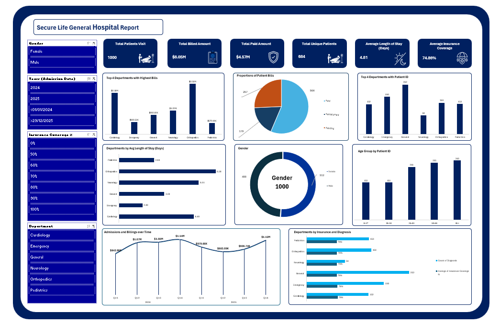

# Data-Driven Insights for Hospital Management: Patient Visits, Billing, and Insurance Analysis

## Introduction

This project analyses patient visit data from Secure Life General Hospital to assess operational and financial performance. Using Microsoft Excel, an interactive dashboard was developed to monitor patient admissions, departmental performance, billing, payment status, insurance coverage, and patient demographics. The analysis provides insights to support management decision-making, improve resource allocation, and strengthen financial monitoring.

## About the Dataset

The dataset contains 1,000 patient visit records covering January 2024 to December 2025. The fields include Patient ID, Patient Name, Age, Gender, Admission Date, Discharge Date, Department, Diagnosis, Total Bill Amount, Insurance Coverage (%), and Payment Status. Additional variables, including length of stay, age group, admission month, and admission year, were derived to support further analysis. Each row represents a patient visit, not necessarily a unique patient, as individuals may visit the hospital multiple times.

# Problem Statement

Secure Life General Hospital has identified changes in patient admissions, outstanding medical bills, and variations in insurance coverage across departments. However, the hospital lacks a consolidated report that provides a clear overview of its operational and financial performance. This project addresses the need to transform raw patient records into meaningful insights through data analysis and an interactive Excel dashboard, enabling management to monitor performance, identify areas requiring attention, and make informed decisions.

## Visualization

Microsoft Excel was used for data cleaning, analysis, calculations, pivot tables, charts, and dashboard creation.

## Key Insights

- Patient visits: The hospital recorded 1,000 visits, with the General Department recording the highest number at 252.
- Departmental billing: Orthopedics recorded the highest total billed amount of 2,553,862.32.
-	Length of stay: Orthopedics had the longest average stay at 8.38 days.
-	Payment status: Of the recorded visits, 56.4% were paid, 25.7% were pending, and 17.9% were partially paid.
-	Insurance coverage: Average recorded insurance coverage was approximately 74.86%, with variations across departments and diagnoses.
-	Age groups: Patients aged 65 and above accounted for the highest number of visits, with 243.
-	Admission and billing trends: Monthly analysis provides a basis for monitoring changes in patient visits and total billed amounts over time.

## Further Recommendations

Management should strengthen payment monitoring by recording actual payments and outstanding balances, review resource allocation in high-demand departments, and investigate the longer average stays in Orthopedics. The hospital should also monitor insurance coverage and reimbursement processes, analyse monthly admission and billing trends, and improve patient record management. Regular dashboard reviews would help management identify emerging issues and evaluate performance over time.

## Conclusion

The analysis provides Secure Life General Hospital with an overview of its patient visits, departmental performance, billing patterns, payment status, insurance coverage, and demographic trends. The interactive Excel dashboard presents these findings in an accessible format to support operational planning and financial monitoring. Although the analysis identifies areas requiring attention, the absence of actual payment and balance data limits the calculation of verified outstanding bills. Improving data collection and reviewing performance indicators regularly would help management make more informed decisions and improve hospital operations.

